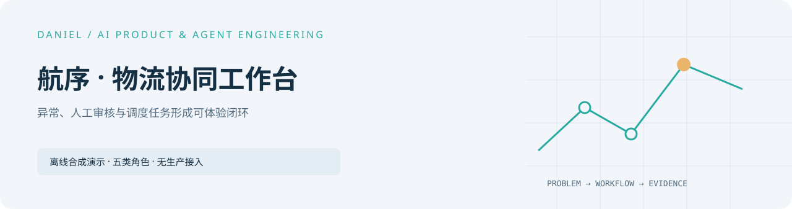
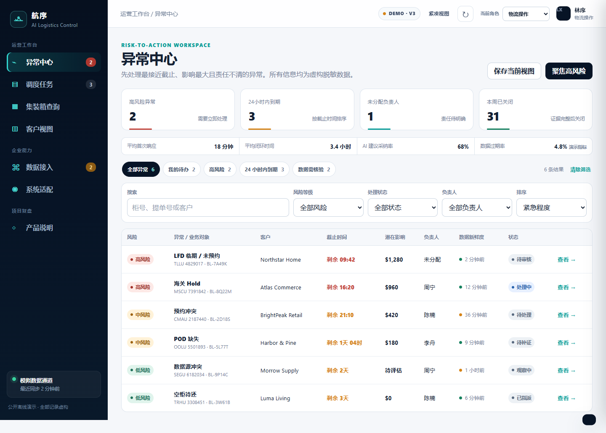

<picture>
  <source media="(prefers-color-scheme: dark)" srcset="docs/assets/cover-dark.svg" />
  
</picture>

# Hangxu Logistics Workbench

[Portfolio](https://github.com/Daniel-24-life/AIfile)

A standalone public product demo for an AI-assisted cross-border logistics desk. It links synthetic exceptions, fixed AI recommendations, human review, dispatch tasks, and a filtered customer status view.



## Run locally

Python 3.11+ serves the static app from the repository root:

```powershell
python -m http.server 4181 --bind 127.0.0.1 --directory dist
```

Open <http://127.0.0.1:4181>. Run the dependency-free Node.js 22+ checks with:

```powershell
node --test tests/policy.test.cjs
node --check dist/app.js
node --check dist/policy.js
```

## Important demo limits

All shipments, people, fees, timestamps, integration health, and AI recommendations are fixed synthetic fixtures. The role picker is an interaction demo, not authentication, authorization, or tenant isolation. Evidence submission and verification buttons only transition in-memory demo state: they do not upload documents or independently validate evidence. Reloading resets the data. There is no backend, external API, model call, or durable audit store.

See the [reference guide](docs/reference-guide.md), [architecture](docs/architecture.md), and [migration record](MIGRATION.md). The original portfolio context remains at [AIfile](https://github.com/Daniel-24-life/AIfile).
