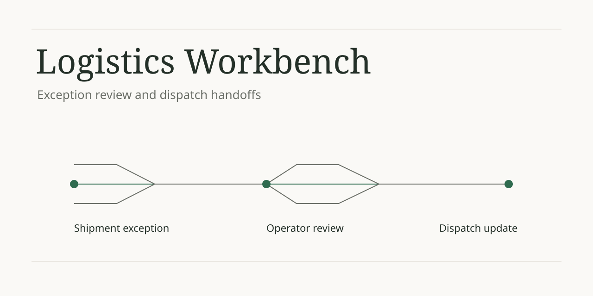
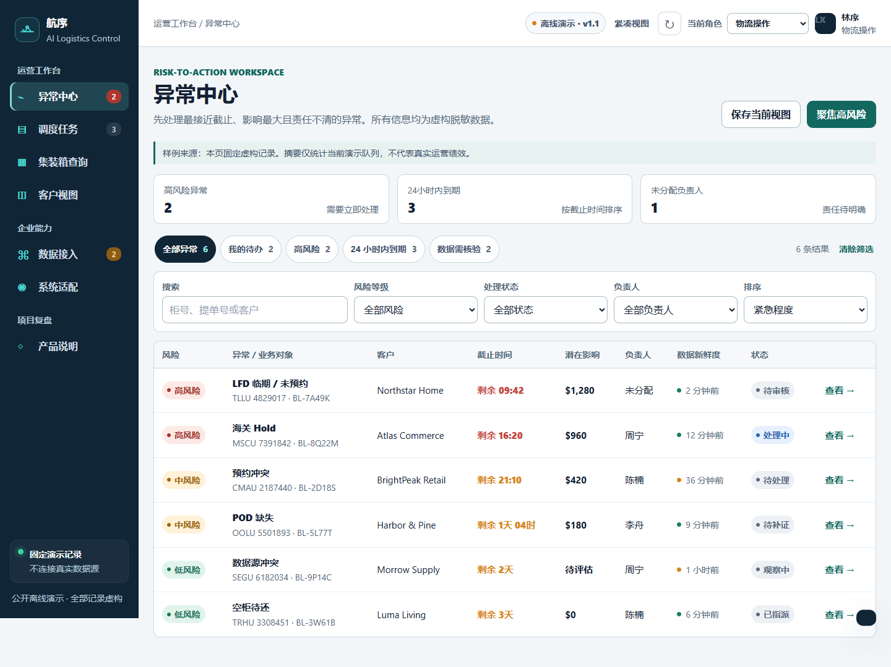
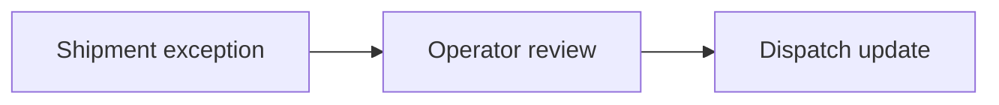

<picture>
  <source media="(prefers-color-scheme: dark)" srcset="docs/cover-dark.svg" />
  <source media="(prefers-color-scheme: light)" srcset="docs/cover-light.svg" />
  
</picture>

# Logistics Workbench

Review a shipment exception, create a dispatch task, and inspect the customer-facing status in one browser workbench.

[▶ Live demo](https://daniel-24-life.github.io/logistics-workbench/) · [中文](README.zh.md) · [](https://github.com/Daniel-24-life/logistics-workbench/actions/workflows/verify.yml) · [MIT](LICENSE) · JavaScript · Node.js 22+

## Demo



## Problem

Shipment exceptions come with deadlines, uncertain evidence, and multiple handoffs. The operator needs a compact view of the next decision and who owns it.

## What I built

- Separate facts, missing evidence, and the proposed action.
- Review an exception and create a dispatch task.
- Switch roles to check what dispatch and customer views expose.
- Apply policy checks to stale exceptions and task transitions.

## How it works



## Run in 60 seconds

```sh
python -m http.server 4181 --bind 127.0.0.1 --directory dist
```

Once the local server starts, open [http://127.0.0.1:4181/](http://127.0.0.1:4181/).

## Tests

**5 tests passed.** [Verified GitHub Actions run](https://github.com/Daniel-24-life/logistics-workbench/actions/runs/45105681653).

```sh
node --test tests/policy.test.cjs
```

## Repository layout

| Path | Contents |
| --- | --- |
| [`dist/index.html`](dist/index.html) | Static entry |
| [`dist/app.js`](dist/app.js) | Exception queue and roles |
| [`dist/policy.js`](dist/policy.js) | Task transition rules |
| [`tests/`](tests/) | Policy tests |

Reference material · [architecture.md](docs/architecture.md) · [VERIFICATION.md](docs/VERIFICATION.md)

<sub>Demo data is synthetic; modeled on real-world workflows. Roles and task changes are browser fixtures. Data resets on refresh.</sub>
