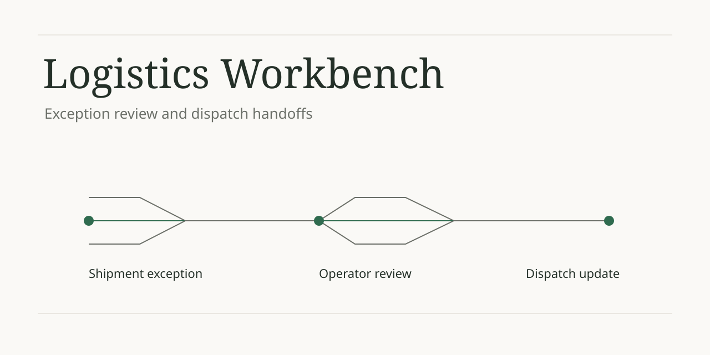
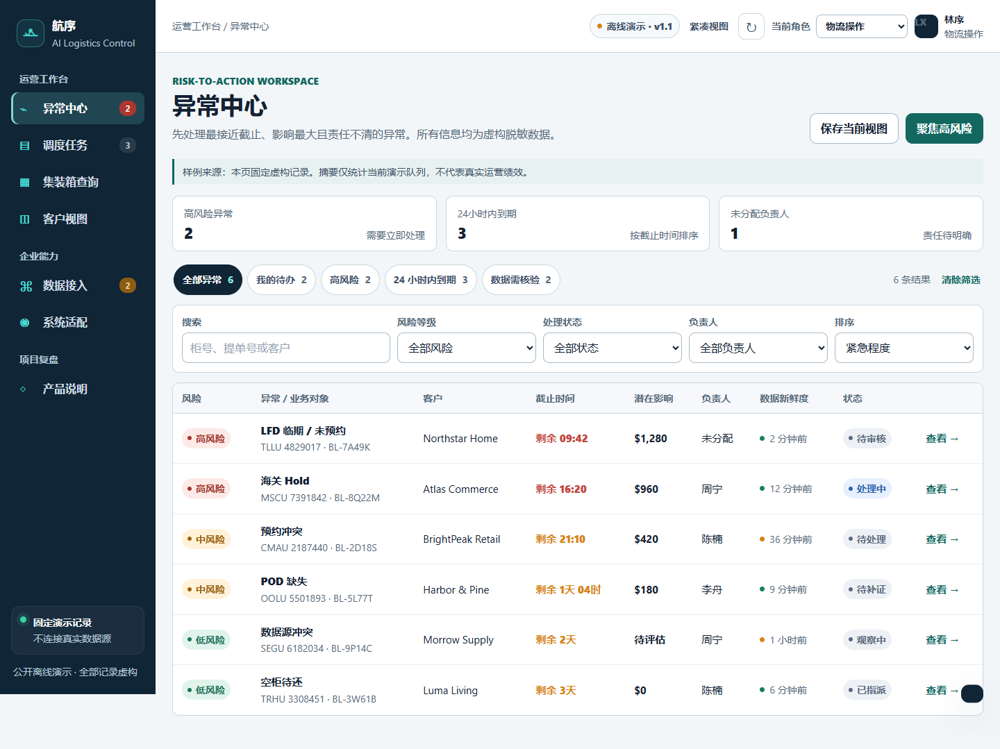

<picture>
  <source media="(prefers-color-scheme: dark)" srcset="docs/cover-dark.svg" />
  <source media="(prefers-color-scheme: light)" srcset="docs/cover-light.svg" />
  
</picture>

# 航序物流协同工作台

把物流异常、人工审核和调度任务放进同一工作台。

[在线演示](https://daniel-24-life.github.io/logistics-workbench/) · [English](README.md) · [](https://github.com/Daniel-24-life/logistics-workbench/actions/workflows/verify.yml) · [MIT](LICENSE) · JavaScript · Node.js 22+

## Demo



## 要解决的问题

运输异常被发现后，还需要明确谁来处理，以及任务已经走到哪一步。

## 实现

- 查看异常事实、证据缺口与建议。
- 审核后生成任务并切换角色验证操作。
- 查看分派进度和客户状态。

## 工作流程


## 快速运行

```sh
python -m http.server 4181 --bind 127.0.0.1 --directory dist
```

启动后打开 [http://127.0.0.1:4181/](http://127.0.0.1:4181/)。

## 测试

实测 **5 项通过**。[通过的 GitHub Actions 运行](https://github.com/Daniel-24-life/logistics-workbench/actions/runs/45105681653)。

```sh
node --test tests/policy.test.cjs
```

## 仓库目录

| 路径 | 内容 |
| --- | --- |
| [`dist/index.html`](dist/index.html) | Static entry |
| [`dist/app.js`](dist/app.js) | Exception queue and roles |
| [`dist/policy.js`](dist/policy.js) | Task transition rules |
| [`tests/`](tests/) | Policy tests |

延伸阅读 · [architecture.md](docs/architecture.md) · [VERIFICATION.md](docs/VERIFICATION.md)

<sub>演示使用合成运单，任务状态存于当前浏览器。</sub>
